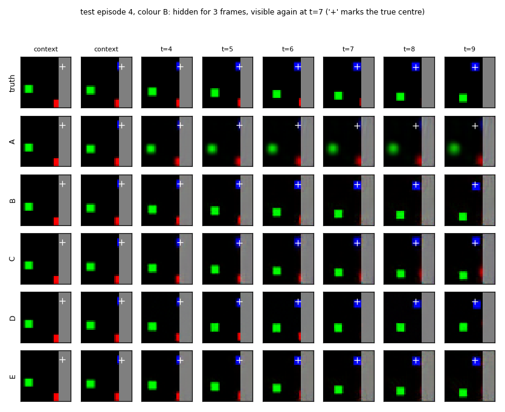
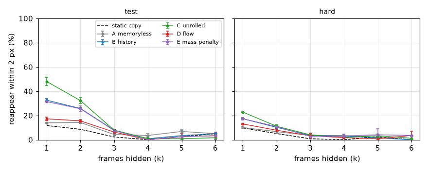

# world-persistence

Do action-conditioned next-frame predictors keep hidden objects consistent through occlusion and long rollouts, and does training on their own rollouts help?

A synthetic benchmark for that question at small scale. Three coloured squares move and bounce in a 32x32 frame, and a grey bar, moved by an action, slides over them and hides them. Five small UNets (about 1.2M parameters each, 3000 training steps each) predict the next frame from the last four frames and the action, and are rolled out for 16 frames. A colour-mask detector then measures whether a square that was hidden for k frames comes back where it should. A last study looks at what int8 quantisation and pruning cost in persistence and in CPU latency.

| model | what it is |
|---|---|
| A | regression, sees only the last frame |
| B | regression, sees the last 4 frames |
| C | like B, trained on 4 unrolled steps that feed back its own predictions |
| D | conditional flow matching, 4 frames, history noise, 8 Euler steps |
| E | like B plus a penalty on the change of each colour's mass, weight chosen on validation |

## Results

Numbers are the mean ± standard deviation over 3 training seeds, on the same fixed episodes for every model (test: 1000 episodes with 1265 occlusion events, hard: 1000 episodes with 1612 events). "static copy" repeats the last context frame. Every results table below is printed by `python scripts/report.py` from the files in `results/`.

- **Inside the memory window, history and rollout training help.** A square hidden for one frame comes back within 2 px in 14 percent of the cases for A, 33 for B, 48 for C, 17 for D and 31 for E (static copy: 12). Pooled over all lengths C reaches 37 ± 3 percent against 26 ± 1 for B. On the hard set the order is the same with smaller numbers (pooled: C 17, B 14, E 14, D 10, A 8, static copy 7).
- **Beyond the window nothing persists.** For k = 4 to 6 no model is above 7 percent (the static copy is at 0 to 5), while B and C still place a colour that never left the view within 2 px in 42 to 78 percent of the control cases. Four true frames hold no pixel of a square that was hidden for four frames, so a model could only keep it by writing it into its own output frames.
- **Rollout training mostly makes tracking better in general.** C also wins on the visible control (74 against 62 percent), and pooled over all lengths the gap between a visible square and a reappearing one is the same (37 against 36 points); per length it is 33 against 28 points at k = 1 and 50 against 62 at k = 3. C has a worse one-step error than B (MSE 1.04 against 0.61, times 1000), a better one at 16 steps (19.9 against 28.2), and trains 1.4 times longer (206 against 146 s).
- **The flow model is last among the models with history.** D reappears within 2 px in 15 percent of all test events (B 26) and places a visible colour in 44 percent of the control cases (B 62). Its signed mass drift is negative at every horizon (-15.8 percent at 16 steps), and on the hard set its median error is the 32 px miss value at every k. On the hard set, however, its pixel MSE at 16 steps is the lowest of all models (38.2 against 48.0 for C and 61.2 for B, times 1000), so pixel error and persistence rank the models differently.
- **The mass penalty does not help.** No weight beats weight 0 (model B) on any of the three validation columns. The weight chosen by the rule, 0.001, gives a model within the seed spread of B on the test set (share 25 ± 0 against 26 ± 1); weights of 0.1 and above are much worse (validation share 11 to 13 percent against 26, mass drift 43 to 83 percent against 21).
- **Frugal inference.** On the best regression model (C), static int8 makes the network 3.5 times smaller (4.79 to 1.35 MB) and keeps persistence (share 40 to 41 percent on 200 test episodes), with no clear latency gain (4.46 to 4.15 ms per call on one CPU thread, inside the measurement noise); for D it costs persistence (share 18 to 14 percent and median error 15.6 to 32.0 px on 100 episodes) while pixel MSE does not move. Pruning 30 percent of the weights is free (share 40 against 41 for the finetune-only control), 50 percent costs 5 points, 70 percent collapses (share 18, median error at the 32 px miss value). Sparsity does not make the CPU run faster.



Rows: the true frames, then A to E, for the first test event in which a colour is hidden for 3 frames among the first 250 test episodes (episode 4, the blue square, visible again at t=7; not picked by hand). The white plus marks the true centre. In this event B to E draw the blue square back at about the right place and A lets it fade. It is one event: at k = 3 only 4 to 8 percent of all test events end within 2 px, for every model.



Share of reappearances within 2 px against the number of hidden frames, mean and standard deviation over 3 seeds, test and hard set.

### Reappearance after occlusion

Share of occlusion events in which the detector finds the square within 2 px of its true centre in the first frame where it is fully visible again, by number of hidden frames k. The first row counts the events.

Test set:

| model | k=1 | k=2 | k=3 | k=4 | k=5 | k=6 | all |
|---|---|---|---|---|---|---|---|
| events | 768 | 268 | 132 | 38 | 39 | 20 | 1265 |
| static copy | 12 | 9 | 2 | 0 | 3 | 5 | 9 |
| A memoryless | 14 ± 1 | 14 ± 1 | 4 ± 1 | 4 ± 2 | 7 ± 1 | 5 ± 0 | 12 ± 1 |
| B history | 33 ± 1 | 26 ± 1 | 8 ± 0 | 1 ± 2 | 3 ± 4 | 5 ± 0 | 26 ± 1 |
| C unrolled | 48 ± 3 | 32 ± 2 | 8 ± 0 | 1 ± 2 | 1 ± 1 | 2 ± 3 | 37 ± 3 |
| D flow | 17 ± 1 | 16 ± 1 | 6 ± 2 | 0 ± 0 | 3 ± 3 | 3 ± 3 | 15 ± 1 |
| E mass penalty | 31 ± 0 | 26 ± 2 | 8 ± 1 | 0 ± 0 | 3 ± 0 | 3 ± 3 | 25 ± 0 |

Median distance in px between the detected and the true centre (32 means the square was not found):

| model | k=1 | k=2 | k=3 | k=4 | k=5 | k=6 | all |
|---|---|---|---|---|---|---|---|
| events | 768 | 268 | 132 | 38 | 39 | 20 | 1265 |
| static copy | 9.6 | 10.5 | 17.6 | 32.0 | 32.0 | 32.0 | 11.1 |
| A memoryless | 13.9 ± 4.0 | 9.0 ± 1.9 | 21.9 ± 8.7 | 25.0 ± 7.3 | 21.8 ± 8.9 | 32.0 ± 0.0 | 13.8 ± 3.2 |
| B history | 3.4 ± 0.2 | 4.4 ± 0.3 | 14.7 ± 2.6 | 27.2 ± 8.3 | 17.9 ± 3.0 | 25.2 ± 11.8 | 4.5 ± 0.3 |
| C unrolled | 2.2 ± 0.2 | 4.4 ± 1.6 | 32.0 ± 0.0 | 32.0 ± 0.0 | 32.0 ± 0.0 | 32.0 ± 0.0 | 3.2 ± 0.5 |
| D flow | 20.3 ± 10.2 | 13.8 ± 4.4 | 32.0 ± 0.0 | 32.0 ± 0.0 | 32.0 ± 0.0 | 32.0 ± 0.0 | 21.2 ± 9.5 |
| E mass penalty | 3.5 ± 0.2 | 4.6 ± 0.3 | 14.1 ± 0.5 | 25.0 ± 8.2 | 21.3 ± 9.3 | 28.7 ± 5.7 | 4.6 ± 0.3 |

Hard set (bar moves up to 4 px per frame and squares up to 1.8 px per frame, both partly outside the training range):

| model | k=1 | k=2 | k=3 | k=4 | k=5 | k=6 | all |
|---|---|---|---|---|---|---|---|
| events | 1061 | 255 | 132 | 95 | 41 | 28 | 1612 |
| static copy | 10 | 5 | 1 | 0 | 2 | 0 | 7 |
| A memoryless | 10 ± 1 | 7 ± 1 | 4 ± 0 | 4 ± 1 | 2 ± 1 | 0 ± 0 | 8 ± 1 |
| B history | 17 ± 0 | 10 ± 0 | 4 ± 2 | 3 ± 1 | 2 ± 3 | 0 ± 0 | 14 ± 0 |
| C unrolled | 23 ± 0 | 11 ± 2 | 4 ± 1 | 2 ± 0 | 3 ± 1 | 1 ± 2 | 17 ± 1 |
| D flow | 13 ± 0 | 8 ± 1 | 3 ± 2 | 2 ± 1 | 1 ± 1 | 4 ± 4 | 10 ± 0 |
| E mass penalty | 17 ± 1 | 11 ± 1 | 3 ± 1 | 3 ± 1 | 4 ± 5 | 4 ± 0 | 14 ± 1 |

Median distance on the hard set:

| model | k=1 | k=2 | k=3 | k=4 | k=5 | k=6 | all |
|---|---|---|---|---|---|---|---|
| events | 1061 | 255 | 132 | 95 | 41 | 28 | 1612 |
| static copy | 10.8 | 15.9 | 19.8 | 32.0 | 32.0 | 32.0 | 13.2 |
| A memoryless | 9.2 ± 0.4 | 11.6 ± 1.0 | 11.3 ± 0.4 | 11.2 ± 0.4 | 9.7 ± 1.0 | 10.4 ± 0.5 | 9.9 ± 0.6 |
| B history | 8.5 ± 0.1 | 12.7 ± 0.4 | 14.3 ± 1.2 | 19.0 ± 11.3 | 26.5 ± 9.5 | 26.1 ± 10.2 | 10.7 ± 0.5 |
| C unrolled | 7.7 ± 1.9 | 28.0 ± 7.0 | 32.0 ± 0.0 | 32.0 ± 0.0 | 32.0 ± 0.0 | 32.0 ± 0.0 | 24.8 ± 12.5 |
| D flow | 32.0 ± 0.0 | 32.0 ± 0.0 | 32.0 ± 0.0 | 32.0 ± 0.0 | 32.0 ± 0.0 | 32.0 ± 0.0 | 32.0 ± 0.0 |
| E mass penalty | 8.1 ± 0.1 | 13.0 ± 0.4 | 21.7 ± 9.1 | 19.4 ± 10.9 | 18.1 ± 3.5 | 25.7 ± 6.3 | 10.2 ± 0.2 |

### Visible control

The same score for a colour of the same episode that stayed fully visible from 7 frames before the reappearance to the reappearance frame (559 of the 1265 test events have one). It separates the cost of hiding a square from the cost of drawing and finding it.

| model | k=1 | k=2 | k=3 | k=4 | k=5 | k=6 | all |
|---|---|---|---|---|---|---|---|
| events | 337 | 105 | 63 | 22 | 21 | 11 | 559 |
| static copy | 17 | 13 | 8 | 0 | 0 | 0 | 13 |
| A memoryless | 18 ± 0 | 18 ± 0 | 9 ± 1 | 3 ± 3 | 0 ± 0 | 0 ± 0 | 15 ± 0 |
| B history | 66 ± 2 | 60 ± 5 | 58 ± 2 | 48 ± 3 | 56 ± 15 | 42 ± 5 | 62 ± 3 |
| C unrolled | 76 ± 1 | 71 ± 1 | 70 ± 4 | 65 ± 3 | 78 ± 7 | 70 ± 10 | 74 ± 1 |
| D flow | 47 ± 1 | 46 ± 2 | 42 ± 4 | 20 ± 5 | 21 ± 11 | 21 ± 10 | 44 ± 1 |
| E mass penalty | 66 ± 2 | 61 ± 3 | 59 ± 3 | 55 ± 8 | 54 ± 20 | 45 ± 18 | 63 ± 2 |

### Mass drift and pixel error

Mass drift is the mean over colours of (predicted mass minus true mass) divided by the mass of a square, in percent, at frame 3 + h; the table gives its absolute value (the signed values are in the output of `scripts/report.py`). Test set:

| model | h=1 | h=4 | h=8 | h=16 |
|---|---|---|---|---|
| static copy | 9.1 | 24.6 | 30.7 | 34.6 |
| A memoryless | 9.6 ± 0.0 | 25.3 ± 1.8 | 40.0 ± 2.6 | 64.3 ± 24.3 |
| B history | 3.6 ± 0.1 | 10.2 ± 0.4 | 19.2 ± 0.9 | 31.8 ± 1.9 |
| C unrolled | 5.3 ± 0.1 | 11.7 ± 0.9 | 17.2 ± 1.7 | 27.0 ± 2.9 |
| D flow | 5.4 ± 0.2 | 15.1 ± 0.6 | 24.2 ± 0.8 | 35.3 ± 1.6 |
| E mass penalty | 3.7 ± 0.1 | 10.1 ± 0.6 | 19.0 ± 0.6 | 31.9 ± 0.6 |

Pixel MSE, times 1000:

| model | h=1 | h=4 | h=8 | h=16 |
|---|---|---|---|---|
| static copy | 21.10 | 71.78 | 88.27 | 104.78 |
| A memoryless | 3.80 ± 0.01 | 16.24 ± 0.32 | 21.92 ± 1.71 | 27.68 ± 5.84 |
| B history | 0.61 ± 0.01 | 5.81 ± 0.22 | 15.48 ± 0.99 | 28.21 ± 1.62 |
| C unrolled | 1.04 ± 0.03 | 3.80 ± 0.07 | 9.22 ± 0.16 | 19.88 ± 1.02 |
| D flow | 1.30 ± 0.04 | 10.62 ± 0.12 | 20.52 ± 0.25 | 25.93 ± 0.50 |
| E mass penalty | 0.61 ± 0.02 | 5.80 ± 0.20 | 15.38 ± 0.65 | 27.85 ± 0.93 |

The signed drift, and the drift, MSE and control tables of the hard set, are in the output of `python scripts/report.py`.

### Mass penalty weight

Model E on seed 0, scored on the validation episodes. Drift is the mean absolute mass drift at h = 4, 8 and 16, the selection rule. The row "0 (B)" is model B on seed 0.

| weight | val drift (%) | val share < 2 px (%) | val mse@16 x1000 | chosen |
|---|---|---|---|---|
| 0 (B) | 21.09 | 26 | 27.21 |  |
| 0.001 | 21.29 | 24 | 27.46 | yes |
| 0.01 | 23.43 | 20 | 28.73 |  |
| 0.1 | 43.42 | 13 | 37.09 |  |
| 1 | 82.95 | 11 | 46.44 |  |
| 10 | 76.96 | 11 | 45.86 |  |

### Frugal inference

The regression model with the highest validation share is C; D is the flow model, both seed 0. Latency is the median of 200 onnxruntime calls on one CPU thread at batch 1 on the Colab VM (2 shared vCPUs); D needs 8 calls per frame. In the precision table "episodes" is the number of test episodes scored (the first 200 for C, the first 100 for D); the pruning table uses all 1000.

Precision:

| model | weights | size (MB) | ms per call | ms per frame | episodes | share < 2 px (%) | median error (px) | drift@16 (%) | mse@16 x1000 |
|---|---|---|---|---|---|---|---|---|---|
| C unrolled | fp32 | 4.789 | 4.46 | 4.5 | 200 | 40 | 2.72 | 26.1 | 20.87 |
| C unrolled | int8 | 1.354 | 4.15 | 4.2 | 200 | 41 | 2.66 | 26.3 | 20.53 |
| D flow | fp32 | 4.811 | 4.64 | 37.1 | 100 | 18 | 15.59 | 31.1 | 26.48 |
| D flow | int8 | 1.356 | 4.57 | 36.6 | 100 | 14 | 32.00 | 45.8 | 26.11 |

Magnitude pruning of every convolution and linear layer, then a 600-step finetune. The row at 0 percent with 600 steps is the finetune control, the row with "none" is the trained model.

| model | sparsity (%) | finetune steps | ms per call | share < 2 px (%) | median error (px) | drift@16 (%) | mse@16 x1000 |
|---|---|---|---|---|---|---|---|
| C unrolled | 0 | none | 4.46 | 39 | 2.85 | 26.1 | 20.86 |
| C unrolled | 0 | 600 | 6.53 | 41 | 2.85 | 25.7 | 19.92 |
| C unrolled | 30 | 600 | 4.52 | 40 | 2.83 | 25.8 | 19.84 |
| C unrolled | 50 | 600 | 4.58 | 36 | 3.35 | 26.4 | 20.81 |
| C unrolled | 70 | 600 | 4.61 | 18 | 32.00 | 36.6 | 21.04 |
| D flow | 0 | none | 4.64 | 15 | 14.69 | 34.2 | 26.36 |
| D flow | 0 | 600 | 5.46 | 15 | 19.23 | 35.4 | 25.50 |
| D flow | 30 | 600 | 4.65 | 15 | 18.67 | 35.6 | 25.75 |
| D flow | 50 | 600 | 4.50 | 15 | 19.27 | 36.9 | 25.78 |
| D flow | 70 | 600 | 7.08 | 12 | 32.00 | 42.9 | 24.54 |

int8 makes both networks 3.5 times smaller; the latency change (4.46 to 4.15 ms for C, 4.64 to 4.57 ms for D) is inside the noise of the measurement. Sparsity gives no CPU speed-up either: the pruned networks are exported dense. The ms column moves between 4.5 and 7.1 ms for networks of identical shape (C at 0 percent with the finetune: 6.53 ms, D at 70 percent: 7.08 ms), so the noise on this shared VM is that large and cells less than about 2.5 ms apart should not be compared. Pixel MSE at 16 steps hides the damage: C at 70 percent sparsity has a 6 percent higher MSE than the finetune control but a persistence share of 18 against 41 percent.

### Training

Colab T4, fp16 autocast, seconds per model and seed (E seed 0 shared the GPU with another job).

| model | params | steps | seconds | final loss x1000 | seeds |
|---|---|---|---|---|---|
| A memoryless | 1179587 | 3000 | 146 ± 15 | 3.74 ± 0.02 | 3 |
| B history | 1182179 | 3000 | 146 ± 11 | 0.55 ± 0.02 | 3 |
| C unrolled | 1182179 | 3000 | 206 ± 1 | 2.08 ± 0.06 | 3 |
| D flow | 1189315 | 3000 | 142 ± 0 | 17.78 ± 0.77 | 3 |
| E mass penalty | 1182179 | 3000 | 196 ± 93 | 0.58 ± 0.03 | 3 |

## What is in the repo

```
src/worldpersist/
  sim.py        occlusion simulator (numpy), fixed splits, true hidden or visible state
  metrics.py    colour masks, centroid detector, reappearance events, mass drift
  models.py     FiLM UNet, regression predictors, flow matching predictor
  training.py   training loops (one step, unrolled, flow, mass penalty), rollout, checkpoints
  frugal.py     ONNX export, int8 quantisation, CPU latency, magnitude pruning
scripts/
  train.py          train and score models, one JSON per run in results/runs/
  select_lambda.py  pick the mass penalty weight of model E on validation
  rescore.py        score saved weights again (adds the visible control to older runs)
  baseline.py       score a static copy of the last context frame
  frugal.py         size, latency and persistence of the int8 and pruned models
  figures.py        rollout strip and reappearance curve
  report.py         print the tables of this README from results/
  run_all.sh        every stage in order
tests/              simulator, metrics, models, training, ONNX parity (about a minute on CPU)
results/            runs/*.json, lambda.json, baseline.json, frugal.json, two figures
```

## Reproduce

```
pip install torch
pip install -e ".[dev,frugal,plots]"
pytest -q

# smoke run on CPU, a few minutes
python scripts/train.py --models a b c d --seeds 0 --steps 20 --base 8 \
    --train-episodes 64 --eval-episodes 30 --out /tmp/smoke/results --ckpt /tmp/smoke/ckpt
python scripts/report.py --out /tmp/smoke/results

# the full study, on a GPU
bash scripts/run_all.sh
python scripts/report.py
```

Data are generated from fixed seeds, nothing is downloaded. The numbers above come from one Colab T4 session (Python 3.13.16, torch 2.14.1).

## Method notes

**Simulator** (`sim.py`). Frames are 32x32x3. Each square has its own colour channel and exact pixel coverage, so sub-pixel motion shows as anti-aliasing and overlapping squares add up instead of hiding each other. The grey bar (0.5 in all channels, 8 px wide, full height) is drawn on top. Square velocity components are drawn in [-1.2, 1.2] px per frame with at least one above 0.4; squares bounce elastically on the walls and pass through each other. The left edge of the bar moves by the action, one of {-2, 0, +2} px per frame, redrawn with probability 0.2 per frame and clipped to the frame. A square is hidden when no part of it is outside the bar. Episodes have 20 frames: 4 context frames and 16 predicted ones. Models get all actions and never a future frame. Splits come from fixed seeds: 4000 train, 500 validation, 1000 test episodes. The hard set (1000 episodes) draws square velocity components in [-1.8, 1.8] and bar moves in {-4, -2, 0, 2, 4}, both partly outside the training range.

**Models** (`models.py`). One UNet (channels 32, 64, 128, GroupNorm, residual blocks, the action enters through FiLM) with 1.18M parameters; D has 1.19M. Regression models output the last frame plus a correction and clamp to [0, 1] when their output is fed back. A sees only the last frame; B, C and E see the last four. C is trained on 4 unrolled steps with gradients through its own predictions. D is conditional flow matching in [-1, 1] units from Gaussian noise: the history frames get noise of level $\sigma \sim U[0, 0.1]$ in training, sampling uses 8 Euler steps, no history noise, one sample per frame from a fixed generator seed. E adds $`\lambda\,\mathrm{mean}_c \bigl(m_c(\hat x_t) - m_c(x_{t-1})\bigr)^2`$ to the pixel loss, where $m_c$ is the mass of colour $c$ divided by 25 (the area of a square in pixels) and $x_{t-1}$ is the true previous frame.

**Budget.** Every model gets 3000 AdamW steps (learning rate 1e-3, 100 warm-up steps, cosine decay, gradient clipping at 1, fp16 autocast), and every step runs the network on 128 frames. C therefore uses 32 windows of 4 unrolled steps per step: the same network work, fewer distinct windows. Apart from $\lambda$ nothing was tuned. Seed 0 of E is the weight 0.001 candidate; it trained next to another job on the same GPU, which is why its time in the training table is high.

**Persistence metrics** (`metrics.py`). The mask of colour $c$ is $m_c = \max(0, x_c - \min_{c'} x_{c'} - 0.1) / 0.9$ on frames clamped to [0, 1]; the grey bar has equal channels, so it gives zero. The detected position is the centroid of $m_c$, and a colour with less than 5 px of mask mass counts as not found. An event is a run of $k$ fully hidden frames followed by the first fully visible frame, with partial frames allowed in between (a run that hides again before that is skipped) and with the visible frame inside the predicted part. The reappearance error is the distance between the detected and the true centre of the square in that frame; a square that is not found gets 32 px. The visible control scores another colour of the same episode that stayed fully visible from 7 frames before to the reappearance frame. Mass drift is the mean over colours of (predicted mass minus true mass) / 25 at frame $3 + h$. On ground truth the detector reads the true centre to 0.05 px (median over the 1265 test events) and scores zero drift and MSE. Runs with $k > 6$ are left out of the tables. The static copy row repeats the last context frame for all 16 steps (`scripts/baseline.py`).

**Scoring pass.** Each run is scored at the end of training, but the visible control was added after A to D had started, so `scripts/rescore.py` scored every saved checkpoint again with the final metric code. The tables come from that pass; GPU kernels are not bit-exact, so a few cells differ in the last digit from the scores printed during training.

**Mass penalty weight.** The first grid was 0.1, 1 and 10. The log at the end of each run prints the test share, and those three runs came out far below B (15.6, 11.9 and 11.1 percent against 26.2 for B on seed 0), so 0.001 and 0.01 were added: the grid was extended after a look at test numbers. The weight itself is still chosen on validation only, by a rule fixed before any E run: the lowest mean absolute mass drift at horizons 4, 8 and 16, seed 0; the other seeds then train with that weight. The smallest weight won, and model B (weight 0) is ahead of it on all three validation columns. A likely reason for the damage at large weights is that the penalty compares with the visible mass of the previous frame, which legitimately drops when the bar covers a square, and the loss cannot tell that from drift. That explanation was not tested.

**Frugal inference** (`frugal.py`, `scripts/frugal.py`). The regression model is the one with the highest validation share of reappearances within 2 px (C), and D is the flow model, both seed 0. The one-step network (for D, the velocity network, called 8 times per frame) is exported to ONNX (opset 17, fp32, dynamic batch) and run with onnxruntime on the CPU of the Colab VM: batch 1, one thread, median of 200 runs after 20 warm-up runs, 10th and 90th percentile and the load average stored next to it. int8 is static quantisation in QDQ format (uint8 activations, per-channel int8 weights, convolutions and matrix products only) calibrated on 200 training-style windows from the validation episodes; it is scored by onnxruntime on the first 200 test episodes (first 100 for D), next to the fp32 torch model on the same episodes. Pruning zeroes the smallest-magnitude weights of every convolution and linear layer, the same share per layer, then finetunes for 600 steps at learning rate 3e-4 with the mask fixed; the 0 percent row is the same finetune without pruning, to separate the effect of the finetune from that of the sparsity. Pruned models are scored on all 1000 test episodes.

## Limits

- Synthetic and tiny: 32x32 frames, three squares, linear motion. Nothing here says how real video models behave.
- The history is four frames. After four fully hidden frames no pixel of the true frames in the window shows the square, so for k >= 4 a model can only guess or carry information in its own output frames. The k = 4, 5, 6 cells rest on 38, 39 and 20 test events (a single event is 3 to 5 points), so they are noisy, and no model with a longer memory or a latent state was tried.
- Three training seeds and 3000 steps per model. D (flow matching) in particular is probably undertrained at this budget, and a longer schedule could change the order of B, C and D. The penalty weight was searched on a five-point grid with one seed, and the grid was extended after a look at test scores (see Method notes).
- The detector reads positions from colour masks, so a square drawn faintly counts as not found (32 px). D draws one noisy sample per frame, and its metrics include that sampling noise.
- The frugal numbers use seed 0 only. int8 is scored on the first 200 (regression) or 100 (flow) test episodes, latency is one thread at batch 1 on a shared 2-vCPU Colab VM (load average recorded in `results/frugal.json`), and unstructured sparsity runs on dense kernels, so it cannot speed up the CPU.
- Mass drift is measured on the visible frame, so it also moves when a square is legitimately hidden; it is a consistency check, not a count of objects.

## License

Apache-2.0, see `LICENSE`.
